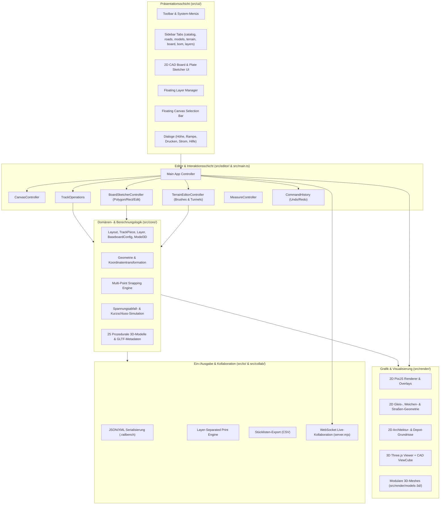

# RAILbench – Systemarchitektur & Technische Dokumentation (v0.6.0)

Diese Dokumentation beschreibt die interne Architektur, Komponentenaufteilung, Datenflüsse und Design-Prinzipien der Modellbahn-Planungssoftware **RAILbench** (**v0.6.0**).

---

## 1. Architektur-Prinzipien & Entwurfsrichtlinien

1. **Strikte Trennung von Domain-Logik und Präsentation**:
   - Das Modul `src/core/` bildet den Kern der Anwendung und enthält ausschließlich reine Mathematik, Datenstrukturen, Snapping-Algorithmen und physikalische Simulationen.
   - **Grundregel**: `src/core/` besitzt keinerlei Abhängigkeiten zu UI-Frameworks, dem DOM oder Grafikbibliotheken (`PixiJS`, `Three.js`). Dadurch ist die gesamte Domänenlogik vollständig headless und mittels Unit-Tests (`vitest`) automatisiert prüfbar.
2. **Modulare Dateigrößen ($\le 1000$ Zeilen pro Datei)**:
   - Jede TypeScript-Quelldatei unter `src/` ist strikt modular aufgebaut und überschreitet maximal 1000 Zeilen Code. Komplexe Subsysteme wie der 2D-Renderer, der 3D-Viewer, die 3D-Modelle und die Sidebar-Tabs sind in klar abgegrenzte Fachmodule unterteilt.
3. **Command-Pattern für Undo/Redo**:
   - Sämtliche zustandsverändernden Benutzeroperationen (Gleise hinzufügen, verschieben, löschen, rotieren, Ebenen- oder Höhenwechsel, Gelände-Bearbeitung) werden über `History` und `Command`-Objekte verwaltet.
4. **Dual-Engine Rendering**:
   - **2D-Präzisions-CAD**: Basiert auf **PixiJS v8** mit WebGL/WebGPU für performante Vektor- und Spritedarstellung im Maßstab 1:1 mit Pan & Zoom.
   - **3D-Perspektive mit 360°/180°-Kamerafreiheit & CAD ViewCube**: Basiert auf **Three.js** mit unbeschränkten `OrbitControls` (inkl. Ansicht direkt von unten unter die Tischplatte), interaktivem **CAD ViewCube (*Ansichtswürfel*)**, dynamischem 24h-Tag/Nacht-Zyklus, prozeduralen 3D-Modellen (`src/render/models-3d/`) sowie `.glb` / `.gltf`-Import.

---

## 2. Modul-Übersicht & Datenfluss

---

## 3. Detaillierte Modulbeschreibungen

### 3.1 `src/core/` – Reiner Domänenkern

* [types.ts](file:///home/nicolai/Projects/railbench/src/core/types.ts):
  * `Layout`: Gesamtstruktur mit `pieces`, `layers`, `models`, `baseboard`, `baseboards`, `activeLayerId`, `feedVoltage`, `locoCurrentMa`, `activeLocosCount`.
  * `TrackPiece`: Gleis- oder Straßeninstanz (`transform`, `connectors`, `elevation`, `powerFeed`, `isIsolator`, `catenary`, `hasBridge`, `hasTunnel`, `hasSignal`, `turnoutDecoder`, `turnoutLantern`, `flexLength`, `flexRadius`, `flexAngle`).
  * `Layer` & `LayerPlate`: Anlagenebene mit Basishöhe (`heightMm`), Sichtbarkeit, Sperrschutz und individuellen Ebenenplatten (`plates` inkl. `shape: "custom"` und `customPolygon`).
  * `BaseboardConfig`: Tisch-Konfiguration (`rect`, `l-shape`, `u-shape`, `t-profile` sowie `custom` mit `customPolygon: Vec2[]`).
* [geometry.ts](file:///home/nicolai/Projects/railbench/src/core/geometry.ts) & [snapping.ts](file:///home/nicolai/Projects/railbench/src/core/snapping.ts):
  * Präzise 2D-Transformationen, Kreisbogen-Geometrie und magnetisches Einrasten für Gleise und Straßen.
* [simulation.ts](file:///home/nicolai/Projects/railbench/src/core/simulation.ts):
  * Multi-Source Dijkstra-Berechnung des Spannungsabfalls (`simulatePowerDrop`) sowie automatische **Kurzschluss-Erkennung (`detectShortCircuit`)** bei ungetrennten Kehrschleifen oder Polaritätskonflikten.
* [models-3d.ts](file:///home/nicolai/Projects/railbench/src/core/models-3d.ts):
  * Definition der **25 integrierten prozeduralen 3D-Modelle** (inkl. *Bekohlungsanlage für Dampfloks* `coaling-station`, *Dieseltankstelle für Dieselloks* `diesel-fuel-station`, *Ringlokschuppen*, *Schiebebühne*, *Drehscheibe*, *Bahnhof Neustadt*, *Berg / Felsmassiv* u.v.m.).

---

### 3.2 `src/editor/` – Interaktive Werkzeuge & Controller

* [canvas-controller.ts](file:///home/nicolai/Projects/railbench/src/editor/canvas-controller.ts) & [track-operations.ts](file:///home/nicolai/Projects/railbench/src/editor/track-operations.ts):
  * Verarbeitet Maus-, Tastatur- und Drag-and-Drop-Interaktionen auf dem 2D-Canvas.
* [board-sketcher-controller.ts](file:///home/nicolai/Projects/railbench/src/editor/board-sketcher-controller.ts):
  * Interaktiver **2D-CAD-Sketcher** zum freien Zeichnen und Bearbeiten von **Tischen (`table`)** und **Ebenenplatten (`plate`)** direkt auf der Arbeitsfläche (`poly`-Polygonstift, `rect`-Rechteckwerkzeug und `edit`-Ecken-/Kanten-Editor).
* [terrain-editor-controller.ts](file:///home/nicolai/Projects/railbench/src/editor/terrain-editor-controller.ts) & [terrain-tunnel-detector.ts](file:///home/nicolai/Projects/railbench/src/editor/terrain-tunnel-detector.ts):
  * Pinsel-Werkzeuge (`raise`, `smooth`, `flatten`, `erase`) und Freihand-Konturen für 3D-Berge sowie automatische Erkennung und Erzeugung von **Berg-Tunneln** für Gleise und Straßen.

---

### 3.3 `src/render/` – 2D-PixiJS & 3D-Three.js Visualisierung

#### A. 2D-Rendering (`PixiJS v8`)
* [renderer.ts](file:///home/nicolai/Projects/railbench/src/render/renderer.ts), [renderer-baseboard.ts](file:///home/nicolai/Projects/railbench/src/render/renderer-baseboard.ts), [renderer-overlays.ts](file:///home/nicolai/Projects/railbench/src/render/renderer-overlays.ts):
  * Rendert Tische, Ebenenplatten, CAD-Sketcher-Vorschauen, Gelände-Pinsel, Gleise, Straßen, Kurzschluss-Warnungen und Messwerkzeuge.
* [track-sprite.ts](file:///home/nicolai/Projects/railbench/src/render/track-sprite.ts), [track-sprite-rail.ts](file:///home/nicolai/Projects/railbench/src/render/track-sprite-rail.ts), [track-sprite-addons.ts](file:///home/nicolai/Projects/railbench/src/render/track-sprite-addons.ts):
  * Maßstäbliche Darstellung von Schotterbett, Schwellen, Schienenprofilen, Weichenzungen, Brücken, Tunneln, Oberleitungen und Spannungs-Heatmaps.
* [model-sprite.ts](file:///home/nicolai/Projects/railbench/src/render/model-sprite.ts), [model-sprite-structures.ts](file:///home/nicolai/Projects/railbench/src/render/model-sprite-structures.ts), [model-sprite-depot.ts](file:///home/nicolai/Projects/railbench/src/render/model-sprite-depot.ts):
  * Detaillierte 2D-Draufsichten aller 25 3D-Modelle inklusive Bekohlungsanlage, Dieseltankstelle, Ringlokschuppen und Bergen.

#### B. 3D-Rendering (`Three.js`)
* [viewer-3d.ts](file:///home/nicolai/Projects/railbench/src/render/viewer-3d.ts) & [viewer-3d-viewcube.ts](file:///home/nicolai/Projects/railbench/src/render/viewer-3d-viewcube.ts):
  * Volle **360°-/180°-Kamerafreiheit** (inkl. Blick direkt von unten unter den Tisch mit automatischer Hallenboden-Ausblendung).
  * Interaktiver **CAD ViewCube (*Ansichtswürfel*)** direkt unter dem Hintergrund-Umschalter mit 6 klickbaren Würfelseiten, 4 Isometrie-Ecken, Maus-Orbit-Drag, Schnellwahl-Leiste und automatischer Deutsch/Englisch-Sprachumschaltung.
  * Dynamischer 24-Stunden-Tag/Nacht-Zyklus mit wandernder Sonne, Mond und Nachtbeleuchtung.
* Spezialisierte 3D-Aufbaumodule:
  * [viewer-3d-baseboard.ts](file:///home/nicolai/Projects/railbench/src/render/viewer-3d-baseboard.ts): 3D-Tische, Tischbeine und Ebenenplatten (inkl. Freiform-Polygonen).
  * [viewer-3d-track.ts](file:///home/nicolai/Projects/railbench/src/render/viewer-3d-track.ts) & [viewer-3d-turnout.ts](file:///home/nicolai/Projects/railbench/src/render/viewer-3d-turnout.ts): 3D-Gleise, Weichen, Drehscheiben und Schiebebühnen.
  * [viewer-3d-bridges.ts](file:///home/nicolai/Projects/railbench/src/render/viewer-3d-bridges.ts), [viewer-3d-catenary.ts](file:///home/nicolai/Projects/railbench/src/render/viewer-3d-catenary.ts), [viewer-3d-roads.ts](file:///home/nicolai/Projects/railbench/src/render/viewer-3d-roads.ts).
  * [src/render/models-3d/](file:///home/nicolai/Projects/railbench/src/render/models-3d/index.ts): Modulare prozedurale 3D-Modelle (u. a. [coaling-station.ts](file:///home/nicolai/Projects/railbench/src/render/models-3d/coaling-station.ts), [diesel-fuel-station.ts](file:///home/nicolai/Projects/railbench/src/render/models-3d/diesel-fuel-station.ts), [mountain.ts](file:///home/nicolai/Projects/railbench/src/render/models-3d/mountain.ts), [mountain-tunnel.ts](file:///home/nicolai/Projects/railbench/src/render/models-3d/mountain-tunnel.ts)).

---

### 3.4 `src/ui/sidebar/` – Modulare Sidebar-Menüs

* [catalog-tab.ts](file:///home/nicolai/Projects/railbench/src/ui/sidebar/catalog-tab.ts): Gleiskatalog-Browser mit Suchfeld und Kategorien.
* [roads-tab.ts](file:///home/nicolai/Projects/railbench/src/ui/sidebar/roads-tab.ts): Straßenkatalog nach Maßstab.
* [models-tab.ts](file:///home/nicolai/Projects/railbench/src/ui/sidebar/models-tab.ts): 3D-Gebäude-, Depot- und Landschaftsbibliothek sowie `.glb`/`.gltf`-Import.
* [terrain-tab.ts](file:///home/nicolai/Projects/railbench/src/ui/sidebar/terrain-tab.ts): Eigenständiges Gelände- & Berg-Menü mit monochromen Icons, Pinsel-Werkzeugen, Berg-Presets und Tunnel-Automatik.
* [board-tab.ts](file:///home/nicolai/Projects/railbench/src/ui/sidebar/board-tab.ts) & [board-sketcher-card.ts](file:///home/nicolai/Projects/railbench/src/ui/sidebar/board-sketcher-card.ts): Tisch- & Ebenenplatten-Editor mit integriertem 2D-CAD-Sketcher.
* [bom-tab.ts](file:///home/nicolai/Projects/railbench/src/ui/sidebar/bom-tab.ts): Live-Stückliste und CSV-Export.
