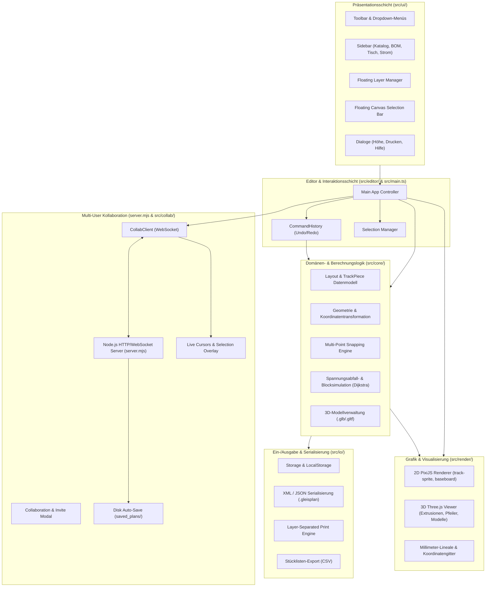

# Railbench – Systemarchitektur & Technische Dokumentation

Diese Dokumentation beschreibt die interne Architektur, Komponentenaufteilung, Datenflüsse und Design-Prinzipien der Modellbahn-Planungssoftware **Railbench** (v0.5.2).

---

## 1. Architektur-Prinzipien & Entwurfsrichtlinien

1. **Strikte Trennung von Domain-Logik und Präsentation**:
   - Das Modul `core/` bildet den Kern der Anwendung und enthält ausschließlich reine Mathematik, Datenstrukturen, Snapping-Algorithmen und physikalische Simulationen.
   - **Grundregel**: `core/` besitzt keinerlei Abhängigkeiten zu UI-Frameworks, dem DOM oder Grafikbibliotheken (`PixiJS`, `Three.js`). Dadurch ist die gesamte Domänenlogik vollständig headless und mittels Unit-Tests (`vitest`) automatisiert prüfbar.
2. **Command-Pattern für Undo/Redo**:
   - Sämtliche zustandsverändernden Benutzeroperationen (Gleise hinzufügen, verschieben, löschen, rotieren, Ebenen- oder Höhenwechsel) werden als gekapselte `Command`-Objekte mit `execute()` und `undo()` ausgeführt.
3. **Dual-Engine Rendering**:
   - **2D-Präzisions-CAD**: Basiert auf **PixiJS v8** mit WebGL/WebGPU für performante Vektor- und Spritedarstellung im Maßstab 1:1 mit Pan & Zoom.
   - **3D-Perspektive & Steigungsvisualisierung**: Basiert auf **Three.js** mit OrbitControls, photorealistischer Beleuchtung, Schattenwurf, maßstabsgetreuen Trägerplatten (Rechteck, L, U, T-Form) sowie 3D-Gebäudemodellen (`.glb` / `.gltf`).
4. **Modulare Gleissystem-Kataloge**:
   - Trennung zwischen universellem Gleis-Geometriemodell und herstellerspezifischen Katalogen (Märklin C H0, Trix C H0, Piko A H0, Roco Line H0, Tillig TT, Fleischmann Piccolo N).

---

## 2. Modul-Übersicht & Datenfluss

---

## 3. Detaillierte Modulbeschreibungen

### 3.1 `src/core/` – Reiner Domänenkern

Das Verzeichnis `src/core/` operiert komplett headless und bildet die mathematische Grundlage:

* [`types.ts`](file:///home/nicolai/Documents/Projects/railbench/src/core/types.ts):
  * `Layout`: Gesamtstruktur mit Metadaten, `pieces`, `layers`, `models`, `baseboard`, `activeLayerId`, `feedVoltage`.
  * `TrackPiece`: Konkrete Gleisinstanz auf der Anlage (ID, Katalogreferenz, `transform: { x, y, rotation }`, Konnektoren, `elevation: { start, end }`, `powerFeed`, `isIsolator`, `layerId`).
  * `Layer`: Anlagenebene mit eindeutiger ID, Name, Basishöhe in Millimetern (`heightMm`), Sichtbarkeit (`visible`) und Bearbeitungsschutz (`locked`).
  * `BaseboardConfig`: Parametrisierung der Trägerplatte (Formen: `rect`, `l-shape`, `u-shape`, `t-profile`, Maße, Holz-/Plattenstil).
  * `Model3D`: Landschaftsobjekt oder Gebäudemodell (integriert oder per `.glb`/`.gltf` importiert).
* [`geometry.ts`](file:///home/nicolai/Documents/Projects/railbench/src/core/geometry.ts):
  * 2D-Transformationen (`transformPoint`, `untransformPoint`, `rotate`).
  * Distanzberechnungen zu Geraden, Liniensegmenten und Kreisbögen (`distToSegment`, `distToArc`).
  * Normalisierung von Winkeln in den Bereich $[0^\circ, 360^\circ[$.
  * Berechnung des geometrischen Mittelpunkts (`getPieceLocalCenter`) und des Drehgriff-Ankerpunkts (`getPieceRotationHandleWorld`).
* [`snapping.ts`](file:///home/nicolai/Documents/Projects/railbench/src/core/snapping.ts):
  * Erkennt offene Gleiskonnektoren in Fangreichweite (Distanz $\le 25\text{ mm}$, Winkelabweichung $\le 15^\circ$).
  * Berechnet präzise Anschlusstransformationen unter Berücksichtigung von Tangentenwinkeln.
* [`simulation.ts`](file:///home/nicolai/Documents/Projects/railbench/src/core/simulation.ts):
  * Modellierung des Schienennetzes als elektrischer Adjazenzgraph.
  * Multi-Source Dijkstra-Algorithmus zur Ermittlung des elektrischen Leitungswiderstands von allen Einspeisepunkten (`powerFeed`).
  * Berücksichtigung von Schienen-Spezifischem Widerstand ($0{,}08\,\Omega/\text{m}$) und Übergangswiderstand an Steckern ($0{,}05\,\Omega$).
  * **Einstellbare Fahrstromlast & Lok-Verbräuche**:
    * Einstellbarer Stromverbrauch pro Lokomotive ($50$ bis $1000\,\text{mA}$, maximal $1\,\text{A}$ pro Lok).
    * Maßstabsabhängige Richtwert-Presets: Spur N & Z ($50\text{--}150\,\text{mA}$, typ. $100\,\text{mA}$), Spur TT ($200\text{--}400\,\text{mA}$, typ. $300\,\text{mA}$), Spur H0 ($300\text{--}600\,\text{mA}$, typ. $450\,\text{mA}$) und Großspuren 1 / G (bis $1000\,\text{mA}$).
    * Einstellbare Anzahl gleichzeitig fahrender Loks (Mehrzugbetrieb, linear summierte Gesamtzuglast in Ampere).
  * Galvanische Trennung an Spannungstrennstellen (`isIsolator`), um analoge Blockabschnitte oder getrennte Boosterbezirke ohne Stromübertragung zu simulieren. Der Übergang wird an genau einem definierten Verbinder (`isolatedConnectorIndex`) getrennt.
* [`models-3d.ts`](file:///home/nicolai/Documents/Projects/railbench/src/core/models-3d.ts):
  * Parsen, Registrieren und Skalieren von 3D-Modellen für die CAD-Zeichnung und Three.js.
* [`layout.ts`](file:///home/nicolai/Documents/Projects/railbench/src/core/layout.ts):
  * Erzeugung von 2D-Polygonkonturen für Grundplatten in Rechteck-, L-, U- und T-Profilform.

---

### 3.2 `src/catalog/` – Gleiskataloge & Geometriedaten

* [`catalog.ts`](file:///home/nicolai/Documents/Projects/railbench/src/catalog/catalog.ts) & [`types.ts`](file:///home/nicolai/Documents/Projects/railbench/src/catalog/types.ts):
  * Registrierung und Verwaltung von Gleissystemen über `CatalogRegistry`.
  * Automatische Berechnung lokaler Konnektoren (`getLocalConnectors`) und Transformation in Weltkoordinaten (`computeWorldConnectors`) für Geraden, Kurven, Weichen (links, rechts, Bogenweichen), Kreuzungen, Dreiwegweichen und Doppelkreuzungsweichen (DKW).
* **Systeme (`src/catalog/systems/`)**:
  * `maerklin-c-h0.ts`: Märklin H0 C-Gleis (inkl. 24188, 24224, Weichen 24611/24612, Dreiweg 24630, DKW 24624, Prellböcken, Anschlussgleisen).
  * `trix-c-h0.ts`: Trix H0 C-Gleis (2-Leiter DCC, basierend auf Märklin C-Gleis Geometrie mit 62xxx-Artikelnummern).
  * `piko-a-h0.ts`: Piko H0 A-Gleis (mit und ohne Bettung).
  * `roco-line-h0.ts`: Roco H0 Roco-Line mit Bettung.
  * `tillig-tt.ts`: Tillig TT Modellgleis.
  * `fleischmann-piccolo-n.ts`: Fleischmann Spur N Piccolo mit Schotterbett.

---

### 3.3 `src/editor/` – Interaktionslogik & Undo/Redo

* [`commands.ts`](file:///home/nicolai/Documents/Projects/railbench/src/editor/commands.ts):
  * Kapselt Aktionen wie `AddPieceCommand`, `MovePieceCommand`, `RemovePieceCommand`, `ToggleFeederCommand`, `ToggleIsolatorCommand`, `MovePiecesToLayerCommand`, `AddModelCommand`, `MoveModelCommand`, `RemoveModelCommand`.
  * `CommandHistory` verwaltet Undo- und Redo-Stacks mit Begrenzung und dirty-Flag.
* [`selection.ts`](file:///home/nicolai/Documents/Projects/railbench/src/editor/selection.ts):
  * Hält den aktuellen Auswahlzustand (Einzel- oder Mehrfachauswahl).

---

### 3.4 `src/render/` – 2D- und 3D-Visualisierung

#### A. 2D-Rendering mit PixiJS v8
* [`renderer.ts`](file:///home/nicolai/Documents/Projects/railbench/src/render/renderer.ts):
  * Verarbeitet Viewport-Events (Pan mit mittlerer Maustaste, stufenloser Zoom mit Mausrad auf Mauszeiger-Fokus).
  * Verwaltet separate Container-Schichten: Grundplatte (`baseboard`), Gleise (`tracks`), 3D-Modellumrisse (`models`), Auswahlbox (`selectionBox`).
* [`track-sprite.ts`](file:///home/nicolai/Documents/Projects/railbench/src/render/track-sprite.ts):
  * **Schotterbett (`drawBallast`)**: Detailgetreue Böschungskontur.
  * **Schwellenband (`drawTies`)**: Mathematisch exakt ausgerichtete Schwellen für Geraden und Kreisbögen. Weichen (24611, 24612, 24630) und DKW (24624) besitzen ein sauberes Schwellenbild, bei dem der Abzweigbogen R2 (24224) radial auffächert.
  * **Schienenprofile (`drawRails`)**: Exakte Spurweiten-Stränge mit Herzstücken und Weichenzungen.
  * **Spannungs-Heatmap (`drawTrackCenterline`)**: Mehrstufiges Glühen und Signallinien mit Farbcodierung (Grün = optimal, Gelb = Warnung, Rot = kritisch oder isoliert).
  * **Auswahlkontur & Drehgriff (`drawSelectionContour`, `drawSelectionGizmo`)**: Bietet einen Rotations-Griff zur Ausrichtung in $7{,}5^\circ$-Schritten.
  * **Gleisnummern- & Spannungs-Plaketten (`drawTrackNumberLabel`, `drawVoltageBadge`)**.
* [`model-sprite.ts`](file:///home/nicolai/Documents/Projects/railbench/src/render/model-sprite.ts):
  * Zeichnet 2D-Architekturgrundrisse für Gebäude und Landschaftselemente mit Abmessungsanzeige und Ausrichtungsmarker.
* [`ruler.ts`](file:///home/nicolai/Documents/Projects/railbench/src/render/ruler.ts):
  * Echtzeit-Millimeterlineale am oberen und linken Canvas-Rand mit Nullpunkt-Fadenkreuz.

#### B. 3D-Rendering mit Three.js
* [`viewer-3d.ts`](file:///home/nicolai/Documents/Projects/railbench/src/render/viewer-3d.ts):
  * Umschaltbar via <kbd>3</kbd> oder <kbd>V</kbd>.
  * Extrudierte 3D-Geometrie für Schotterbett und Vollprofil-Schienen (Geraden sowie Kreisbögen).
  * Dreidimensional modellierte Weichen für 24611, 24612 und 24630 auf Basis von Stammgleis 24188 und Bogen 24224.
  * Automatische zylindrische Brückenpfeiler bei angehobenen Gleistrassen ($> 15\text{ mm}$).
  * Tisch-Grundplatte im Profil mit wählbaren Oberflächentexturen (`wood`, `slate`, `plywood`, `dark-wood`, `white`).
  * Schattenwurf (Directional Light mit Shadow-Map und Ambient Light).
* [`builtin-models-3d.ts`](file:///home/nicolai/Documents/Projects/railbench/src/render/builtin-models-3d.ts):
  * Prozedurale Low-Poly-Meshes für Bahnhof Neustadt, Stellwerk W1, Lokschuppen, Fachwerkhaus, Wasserturm, Signale, Bäume und Lampen.

---

### 3.5 `src/io/` – Dateiformate, Export & Druck

* [`serialize.ts`](file:///home/nicolai/Documents/Projects/railbench/src/io/serialize.ts):
  * XML- und JSON-Serialisierung im primären **`.railbench`**- sowie `.gleisplan`-Format.
  * Persistiert Gleise, Konnektoren, Ebenen, Höhen/Rampen, Einspeisepunkte, Isolatoren, Grundplatten und 3D-Modelle.
* [`export.ts`](file:///home/nicolai/Documents/Projects/railbench/src/io/export.ts):
  * Erstellt die Stückliste (BOM) mit Teilenummer, Bezeichnung, System, Mengenangaben und Gesamtlänge in Metern als CSV-Datei.
* [`print-dialog.ts`](file:///home/nicolai/Documents/Projects/railbench/src/io/print-dialog.ts):
  * Mehrseitiger Druck-Generator mit **Layer-Separation**.
  * Rendert für jede Ebene eine isolierte Druckseite mit exakt identischem Maßstab und Bounding-Box (ermöglicht das Aufeinanderlegen transparenter Ausdrucke zur Höhenkontrolle).
  * Enthält ein Teileverzeichnis auf jeder Seite sowie eine zusammenfassende Gesamtübersicht.

---

### 3.6 `src/ui/` & `src/settings/` – Benutzerführung, Menüs & Konfiguration

* [`toolbar.ts`](file:///home/nicolai/Documents/Projects/railbench/src/ui/toolbar.ts):
  * Brand-Hauptmenü (`RAILbench`), Werkzeugleiste und Dropdowns (Datei, Bearbeiten, Ansicht, Hilfe, Einstellungen).
  * Schnellzugriffe für Undo, Redo, Drehung in $7{,}5^\circ$-Schritten, Auswahlsperre aufheben (<kbd>Alt+L</kbd>), Ansichts-Reset, 3D-Toggle, Lineale, etc.
* [`drag-preview.ts`](file:///home/nicolai/Documents/Projects/railbench/src/ui/drag-preview.ts):
  * Hochpräziser 1:1-CAD-Vorschau-Generator für Drag & Drop direkt aus dem Katalog auf das Canvas (Gleisbögen, Schotterbett, Schwellen, Straßen und Modellgrundrisse).
* [`selection-bar.ts`](file:///home/nicolai/Documents/Projects/railbench/src/ui/selection-bar.ts):
  * Kompakte schwebende Aktionsleiste auf dem Canvas mit Icon-Pills für Höhen-/Rampendialog (`⤉`), Millimeter-Eingabe, Grad-Winkel (`↻`), Gleiseinspeisung (`⚡`), Trennstellen (`⊘`), Oberleitung (`⌁`), Decoder (`📟`), Laternen (`💡`) und Löschen (`🗑`).
* [`welcome-dialog.ts`](file:///home/nicolai/Documents/Projects/railbench/src/ui/welcome-dialog.ts):
  * Interaktiver Start- & Willkommensbildschirm mit Schnellaktionen (Zuletzt geöffneter Plan, Neuer Plan, Demo-Layout, Datei durchsuchen) und wählbarem Startverhalten.
* [`settings-manager.ts`](file:///home/nicolai/Documents/Projects/railbench/src/settings/settings-manager.ts):
  * Verwaltet benutzerspezifische Einstellungen im LocalStorage und bietet `resetPersonalConfig()`, um persönliche Einstellungen und Caches ohne Beeinträchtigung des aktuellen Gleisplans zurückzusetzen.
* [`sidebar.ts`](file:///home/nicolai/Documents/Projects/railbench/src/ui/sidebar.ts):
  * Akkordeon-Seitenleiste: Standardisierter Gleiskatalog-Browser, Straßenbau, Live-Stückliste, Grundplatten-Editor, 3D-Modell-Bibliothek mit Ein-Schritt-Maßstabswahl und Kategorie-Filtern.
* [`power-dialog.ts`](file:///home/nicolai/Documents/Projects/railbench/src/ui/power-dialog.ts):
  * Modales Einstellungsfenster für Versorgungsspannung (`Custom Voltage`) und Lokomotiv-Stromaufnahme / Gesamtzuglast (stufenloser Slider, Maßstabs-Presets N/Z, TT, H0, Mehrzug-Stepper und automatische 1A-Begrenzung).
* [`right-sidebar.ts`](file:///home/nicolai/Documents/Projects/railbench/src/ui/right-sidebar.ts):
  * Floating Layer Manager: Anzeige aller Ebenen geordnet nach Höhe, Sichtbarkeitstoggle (<kbd>👁️</kbd>), Bearbeitungsschutz (<kbd>🔒</kbd>), Löschen, Ebene oben/unten hinzufügen und Inline-Ebenenumbenennung.
* [`help-dialog.ts`](file:///home/nicolai/Documents/Projects/railbench/src/ui/help-dialog.ts):
  * Interaktives Hilfefenster mit Themen-Navigation (Übersicht, Tastenkombinationen, Ebenen & Steigungen, 3D-Ansicht, Spannungsabfall, Gleissysteme).
* [`height-dialog.ts`](file:///home/nicolai/Documents/Projects/railbench/src/ui/height-dialog.ts):
  * Dialog zum Zuweisen ausgewählter Gleise zu einer Ebene oder zum Berechnen von Rampen und Neigungen mit Steigungswarnung ($> 3{,}5\%$).

---

## 4. Tastaturkürzel-Referenz (Auszug)

| Kürzel | Aktion | Bereich |
|---|---|---|
| <kbd>Ctrl</kbd> + <kbd>N</kbd> / <kbd>O</kbd> / <kbd>S</kbd> | Neu / Öffnen (.railbench) / Speichern | Datei |
| <kbd>Ctrl</kbd> + <kbd>P</kbd> | Layer-separierter Plandruck | Druck |
| <kbd>Ctrl</kbd> + <kbd>E</kbd> | Stückliste als CSV exportieren | Export |
| <kbd>Ctrl</kbd> + <kbd>Z</kbd> / <kbd>Y</kbd> | Rückgängig / Wiederherstellen | Bearbeiten |
| <kbd>R</kbd> / <kbd>Shift</kbd> + <kbd>R</kbd> | Selektion um $+7{,}5^\circ$ / $-7{,}5^\circ$ drehen | Bearbeiten |
| <kbd>Alt</kbd> + <kbd>L</kbd> | Auswahlsperre aufheben (Gesperrte & gelöschte Ebenen auswählen) | Ebenen |
| <kbd>M</kbd> | Höhe / Rampe / Ebenenwechsel öffnen | Ebenen |
| <kbd>F</kbd> | Stromeinspeisepunkt setzen/entfernen (⚡) | Elektrik |
| <kbd>I</kbd> | Spannungstrennstelle / Isolator setzen (⊘) | Elektrik |
| <kbd>Shift</kbd> + <kbd>D</kbd> / <kbd>L</kbd> | Weichendecoder / Weichenlaterne umschalten | Elektrik |
| <kbd>P</kbd> | Fahrspannungsabfall-Heatmap umschalten | Elektrik |
| <kbd>3</kbd> oder <kbd>V</kbd> | 3D-Ansicht umschalten | Ansicht |
| <kbd>Shift</kbd> + <kbd>L</kbd> | Millimeter-Lineale ein-/ausblenden | Ansicht |
| <kbd>F1</kbd> oder <kbd>?</kbd> | Hilfe & Feature-Guide öffnen | Hilfe |

---

## 5. Build- & Distribution-Architektur

Railbench wird über Electron und Vite kompiliert und bereitgestellt:
- **Web / Frontend**: `npm run build` führt TypeScript-Typechecks (`tsc`) durch und bündelt Assets via Vite.
- **Electron Main Process**: `npm run build:electron` kompiliert `electron/main.ts` und setzt CJS-Kompatibilität.
- **Target-Plattformen**:
  - **Linux**: AppImage (`x64`, `arm64`) und Flatpak (`scripts/build-flatpak.sh`).
  - **Windows**: Portable Executables & NSIS Installer (`x64`, `arm64`).
  - **macOS**: Universal ZIP & DMG Bundles (`x64`, `arm64`).
