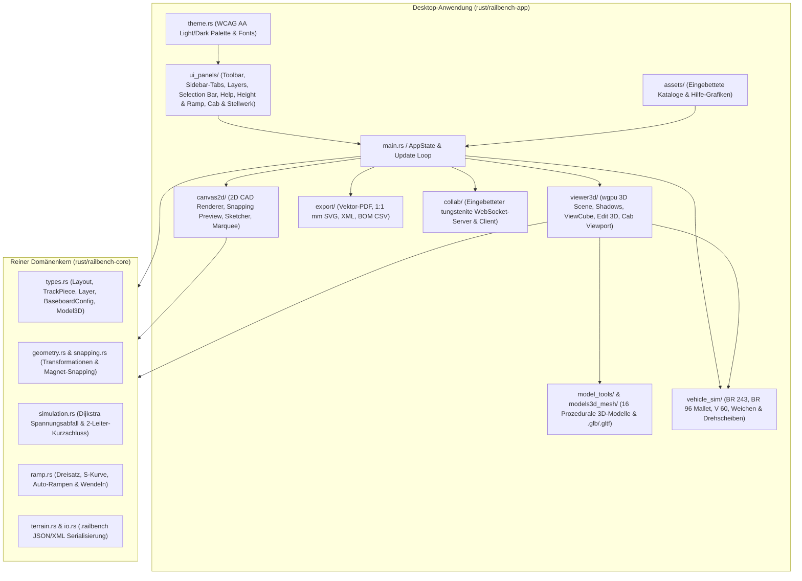

# RAILbench – Systemarchitektur & Technische Dokumentation

Diese Dokumentation beschreibt die interne Architektur, Crate-Aufteilung, Datenfluesse und Rendering-Engines der nativen Rust-Desktopanwendung **RAILbench** (`rust/`).

---

## 1. Architektur-Prinzipien & Entwurfsrichtlinien

1. **Strikte Trennung von Domänenlogik und UI/GPU**:
   - Die Bibliothek-Crate [`railbench-core`](../rust/railbench-core/src/lib.rs) bildet den reinen Domänenkern und enthält ausschließlich Geometrie-Mathematik, Datenstrukturen, Snapping-Algorithmen, Rampenberechnung, Terrain-Meshing und die elektrische Netzsimulation.
   - **Grundregel**: `railbench-core` besitzt keinerlei Abhängigkeiten zu `egui`, `eframe`, `wgpu` oder Dateidialogen und lässt sich vollständig headless testen (`cargo test -p railbench-core`).
2. **Modulare Fachmodule in `railbench-app`**:
   - Die Desktop-Anwendung [`railbench-app`](../rust/railbench-app/src/main.rs) strukturiert UI-Panels, 2D-CAD-Canvas, 3D-`wgpu`-Engine, Fahrzeugsimulation, Exporte und WebSocket-Kollaboration in klar getrennte Untermodule.
3. **Snapshot-basiertes Undo/Redo (`VecDeque<LayoutSnapshot>`)**:
   - Zustandverändernde Operationen (Gleise, Straßen, Gebäude, Rampen, Gelände, Platten, Verkabelung) sichern kompakte Layout-Snapshots für zuverlässiges Rückgängigmachen (`Ctrl+Z`) und Wiederholen (`Ctrl+Y`).
4. **Dual-Engine Rendering (`egui` 2D + `wgpu` 3D)**:
   - **2D-Präzisions-CAD (`canvas2d/`)**: Vektor- und Gleisrendering über `egui::Painter` im exakten Millimeter-Maßstab mit Pan, stufenlosem Zoom, Linealen, Tab-gefilterter Auswahl (`SelectionScope`), CAD-Sketcher, Terrain-Pinsel und Live-Spannungs-Heatmap.
   - **Hardware-beschleunigter 3D-Viewer (`viewer3d/`)**: Native `wgpu`-Render-Pipeline (4x MSAA, Tiefenpuffer, dynamischer 24h-Tag/Nacht-Sonnenlauf & Schatten, Hallen- & CAD/Minimal-Umgebung, **CAD ViewCube**, direktes **3D-Bearbeiten**, abnehmbares **Cab View & Stellwerk**-Fenster sowie **transparente Dächer** bei Lokschuppen und Ringlokschuppen).

---

## 2. Workspace-Übersicht & Datenfluss



---

## 3. Verzeichnisstruktur (`rust/`)

### 3.1 `rust/railbench-core/src/` – Headless Domänenkern
* [lib.rs](../rust/railbench-core/src/lib.rs): Öffentliche Kern-API.
* [types.rs](../rust/railbench-core/src/types.rs): `Layout`, `TrackPiece`, `Layer`, `LayerPlate`, `BaseboardConfig`, `Model3D`, `TerrainMountain`, `TerrainField`.
* [geometry.rs](../rust/railbench-core/src/geometry.rs) & [snapping.rs](../rust/railbench-core/src/snapping.rs): Kreisbogen- und Weichen-Geometrie sowie Multi-Point-Snapping.
* [simulation.rs](../rust/railbench-core/src/simulation.rs): Multi-Source Dijkstra-Berechnung des Spannungsabfalls (`simulate_power_drop`) sowie automatische Kurzschluss-Erkennung bei ungetrennten Kehrschleifen.
* [ramp.rs](../rust/railbench-core/src/ramp.rs): Steigungs-, Ausrundungs- und automatische Wendel-/Rampengenerierung.
* [terrain.rs](../rust/railbench-core/src/terrain.rs) & [io.rs](../rust/railbench-core/src/io.rs): Höhenfeld-Datenmodell und verlustfreies `.railbench` JSON/XML I/O.

### 3.2 `rust/railbench-app/src/` – Native UI, Rendering & Simulation
* **App-Kern**: `main.rs`, `app_state.rs`, `app_update.rs`, `app_actions.rs`, `app_editing.rs`, `app_selection_ops.rs`, `app_shortcuts.rs`, `app_io.rs`, `perf_monitor.rs`, `theme.rs`, `i18n.rs`.
* **Eingebettete Daten & Kataloge**: `catalog/` mit **23 Gleis-** und **7 Straßensystemen** aus [`rust/railbench-app/assets/catalogs/`](../rust/railbench-app/assets/catalogs/) sowie Hilfe-Grafiken aus [`rust/railbench-app/assets/help/`](../rust/railbench-app/assets/help/).
* **2D-CAD & Werkzeuge**: `canvas2d/`, `board_tools/`, `cad_tools/`, `terrain_tools/`, `ramp_tools/`, `power_sim.rs`.
* **3D-Engine (`wgpu`) & Gebäude**: `viewer3d/` (inkl. `gpu/`, `viewcube/`, `edit3d/`, `cab_viewport.rs`), `model_tools/`, `models3d_mesh/`, `bridges_3d/`, `tunnels_3d/`, `turntables_3d/`, `trains_3d/`.
* **Oberfläche (`ui_panels/`)**: `top_bar_menu.rs`, `top_bar_quick.rs`, `left_tabs.rs`, `catalog_tab.rs`, `terrain_tab.rs`, `board_tab.rs`, `bom_tab.rs`, `right_sidebar.rs`, `selection_bar.rs`, `height_panel/`, `export_dialog.rs`, `help_dialog.rs`, `cab_window/`, `dialogs.rs`, `extra_dialogs.rs`, `settings_help_dialogs.rs`, `welcome_demo_dialogs.rs`.
* **Export & Multi-User Sync**: `export/` (Multi-Page Vektor-PDF, 1:1 mm SVG, XML, Stücklisten-CSV) und `collab/` (eingebetteter WebSocket-Server & Client via `tungstenite`).

---

## 4. Tests & Qualitätssicherung

```bash
cd rust
cargo test
```

Die Testsuite prüft sowohl reine Berechnungslogik in `railbench-core` als auch Headless-`egui`-UI-Panels, Auswahl-/Drag-Isolation, Katalogdaten, WCAG-AA-Kontraste im Light/Dark-Design, PDF/CSV-Exporte sowie `wgpu`/3D-Szenengenerierung in `railbench-app`.
